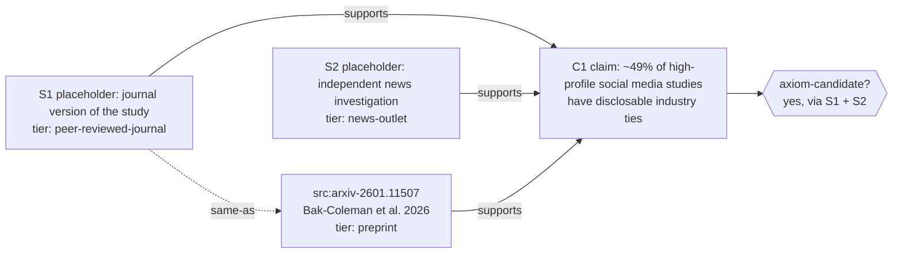

# Graph schema

How Custodian records claims, sources, design items and decisions as a graph. This is a schema document. Seed data following it lives in [graph/graph.yaml](../graph/graph.yaml). No code reads it yet.

## Node types

| Type | What it holds |
|---|---|
| `claim` | A statement someone made or a finding a source reports. |
| `source` | A document, dataset, transcript or page that a claim can be traced to. |
| `primitive` | One of the three core primitives (verifiability, disagreement preserved, incentive transparency). |
| `design-item` | A proposed part of the system (for example open mode, scoped mode, per-proposal join keys). |
| `decision` | A dated choice about the design, with who made it. |
| `conflict` | A recorded tension between two or more nodes that the system does not resolve. |
| `axiom-candidate` | A claim that meets the axiom rule below. It is a status a claim earns, not a verdict. |

## Edge types

| Edge | Meaning |
|---|---|
| `supports` | The source node gives grounds for the target node. |
| `contradicts` | The source node gives grounds against the target node. |
| `derives-from` | The source node was produced from the target node (a summary, re-analysis or quotation). |
| `same-as` | The two nodes are the same item recorded twice (for example a preprint and its published version, or one article syndicated by two outlets). |
| `cites` | The source node refers to the target node, without saying whether it agrees. |

Edges are directed and carry their own `id`, `created`, `provenance` and `status`. A `contradicts` edge never removes or hides a `supports` edge. Both stay visible.

## Required properties on every node

| Property | Values | Notes |
|---|---|---|
| `id` | stable string, e.g. `src:arxiv-2601.11507` | Never reused. |
| `type` | one of the node types above | |
| `label` | short plain-language text | Neutral wording (see agents.md). |
| `created` | ISO 8601 date | |
| `provenance` | author, agent or document that created the node | For agents, include the agent name and model or tool version. |
| `status` | `active`, `disputed`, `superseded`, `withdrawn` | `superseded` and `withdrawn` nodes stay in the graph. |
| `verification_tier` | see below | Required on every node. |
| `verification_status` | `confirmed`, `self-description`, `not-verified` | Same markers as the prior-art index. |
| `links` | list of URLs or DOIs | Required for `source` nodes; optional otherwise. |
| `retention` | `permanent` or an end date | Per-speaker data is never `permanent` (see agents.md rule d). |

### `verification_tier` enum

| Value | Use for |
|---|---|
| `peer-reviewed-journal` | Published after peer review in a journal or reviewed proceedings. |
| `preprint` | arXiv, OSF/SocArXiv and similar, not yet peer reviewed. |
| `institutional-report` | Universities, funders, public bodies, standards bodies, official project or programme pages of institutions. |
| `news-outlet` | Edited news media. |
| `creator-content` | Blogs, newsletters, podcasts, personal or company self-descriptions, code repositories describing their own project. |
| `n/a` | Allowed only on nodes that are not sources and have no cited source (see below). |

How the tier applies to nodes that are not sources:
- **`claim`**: inherits the tier of the source it was taken from. A claim backed by several sources lists the highest tier, and the full set is read from its incoming edges.
- **`primitive`, `design-item`, `decision`, `conflict`**: `n/a`, unless the node cites a source, in which case it inherits that tier for reference only. Tiers never make a decision more or less valid.
- **`axiom-candidate`**: keeps the tiers of its supporting sources, which is what qualified it.

## The axiom rule

A node qualifies as `axiom-candidate` only if it has **two or more independent incoming `supports` edges from nodes with different `verification_tier` values**.

Two supporting nodes are **independent** only if all of these hold:
1. They are not linked by `same-as` (directly or through a chain).
2. Neither `derives-from` the other, and they do not both `derives-from` the same source.
3. One does not merely `cites` the other as its basis for the claim (a news story reporting a paper is not independent of the paper).
4. They have different provenance (not the same author group or the same organisation publishing twice).

Operational checks:
- Count only `supports` edges with `status: active`.
- `n/a` is not a tier for this rule.
- Any active `contradicts` edge does not remove axiom-candidate status, but it must be shown next to it, and the node's `status` becomes `disputed`.
- Axiom-candidate status is recomputed when edges change. It is never set by hand.

## Example subgraph

Claim taken from the prior-art index (entry 5): about half of high-profile social media studies have disclosable industry ties.

Note on honesty: in the index today this claim has **one** source, the arXiv preprint (`preprint`). It has no peer-reviewed or news source yet, so **in the real graph it is not an axiom-candidate**. The example below shows the shape the rule needs; `S1` and `S2` are placeholders, not sources we have found.

| Node | Type | Tier | Independent of the others? | Counts toward the rule? |
|---|---|---|---|---|
| `src:arxiv-2601.11507` | source | preprint | No: `same-as` S1 | Counts once, together with S1 |
| S1 (placeholder) | source | peer-reviewed-journal | Yes from S2 | Yes |
| S2 (placeholder) | source | news-outlet | Yes, only if it does its own reporting and does not just cite the paper | Yes |
| C1 | claim → axiom-candidate | inherits | | Two independent supports, two different tiers: qualifies |

If S2 only reported the paper (`cites` it as its basis), it would not be independent, and C1 would not qualify.

## Decisions carry their tensions

Every `decision` node is linked to what pulls against it, in one of two ways:
- a `contradicts` edge from each node it is in tension with (a primitive, a finding, another decision), or
- a `conflict` node that both sides point to, when the tension involves more than two nodes.

The system never resolves a `conflict` node. A person can record a later `decision` that addresses it, and the conflict stays in the graph with a link to that decision.
