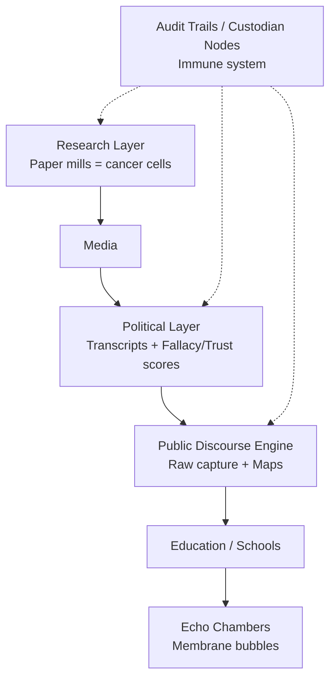

# Custodian Organism Slide Deck Outline

## Slide 1: Title
**The Custodian Organism: An Auditable Human Knowledge Network**
Transparent discourse · Preserved dissent · Incentive transparency · Against infected information

## Slide 2: Inception
From Samtalið (Iceland Oct 10 2026, President Halla Tómasdóttir) and the manifesto:
- Appetite for conversation proven; raw signal lost to human facilitators.
- Replace bottleneck with transparent AI-assisted civic layer: raw capture (round tables, voice, text, art) + consent + crypto protection.
- Aggregation without editor; preserve dark regions.
- Start small: one node, one table, one honest record.

## Slide 3: Core Primitives (DNA)
1. **Verifiability**: Audit trail – source, method, timestamp, who stood behind it. Check, don't trust.
2. **Disagreement Preserved**: Keep contradictions visible with provenance. Reader weighs; system does not resolve.
3. **Incentive Transparency**: What the funder/actor gains if the finding holds.
AI’s job: prevent quiet deletion of true-shaped material, not decide truth.

## Slide 4: The Human Knowledge Network as Organism
Layers of flow: Research → Media → Politics → Public Discourse → Education → Echo Chambers.
Whole system as living organism. Infected research as cancer cells. Independent nodes as immune system.

## Slide 5: Research Layer – Paper Mills as Cancer
- ~49% of high-profile social media research has industry ties (majority undisclosed). arXiv:2601.11507.
- Suspected paper-mill articles: 50-100% more citations despite fewer readers (PNAS 2026).
- Political science abstracts: 94% non-null; ~2% null-only (nulls suppressed 10-100x).
Trace affiliations: funders → authors → citations → media → politicians. Incentive transparency exposes motives.

## Slide 6: Political Knowledge Network Layer
Congressional / parliamentary transcripts as knowledge graph.
- Logical fallacy detection (DISPUTool 3.0 / RAG approaches on ElecDeb60to20).
- Historical truthfulness scores (PolitiFact-style over time).
- Trust metrics linked to past accuracy and use of verified vs infected sources.
Accountability: flag claims rooted in cancer research or high fallacy density.

## Slide 7: Infection Cascade – Mind Virus / Collective Unconscious
Flawed research (cancer) → media amplification → political speech → public discourse → schools/education → echo chambers (bubbles with interpretive membranes).
Like flawed AI agent factory cascading into more flawed agents.
Collective unconscious infected; dark regions show where conversation doesn't go.

## Slide 8: Public Discourse Engine
Connects raw capture to the knowledge network.
Flags statements based on infected research or high-fallacy speakers.
Aggregates discourse maps preserving disagreement and dark regions.
Cryptographic audit of neutrality and non-deletion.
Informs public: “this claim rests on research with undisclosed industry ties.”

## Slide 9: Network of Independent Custodian Nodes
Cooperate but maintain separation (error correction via network).
Self-care floors. Glass-box transparency + cryptographic proofs.
Forest from seed: Iceland start, grow like independent trees.
VitNet-style contract spine for civic ops.

## Slide 10: System Architecture (Mermaid)

## Slide 11: Book / Series Concept
Visual organism maps, infection cascades, node forests.
Voice-first manifesto + conversations with the machine.
Iceland niche + X de-slop with texture.
Generated images for metaphors: cancer in knowledge graph, membrane bubbles, immune audit nodes, forest of nodes.
Expand manifesto into multi-chapter organism narrative.

## Slide 12: Next Steps
- Enrich repo with full slide source and Mermaid files.
- Prototype politician transcript + fallacy layer.
- Link research integrity database to political claims.
- Pilot one node round table with audit trail.
- Grow the forest.

---
Companion PPTX generated with python-pptx covering the same structure.
