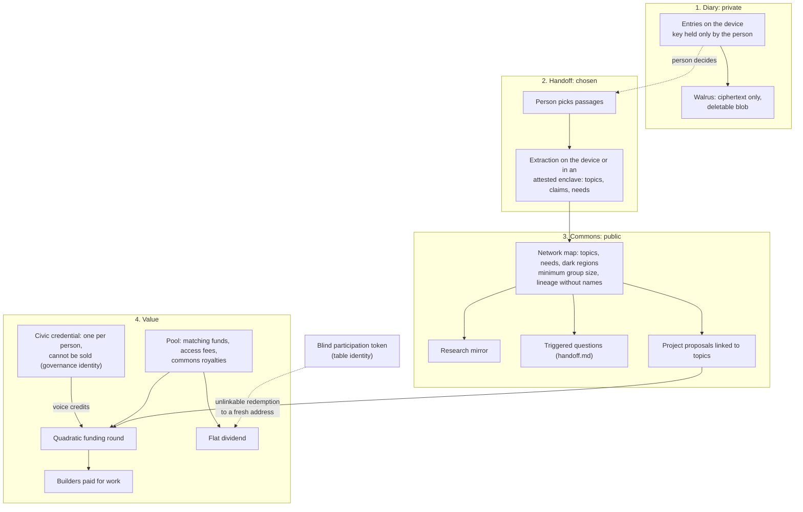

# Diary, commons and coin (vision / hypothesis)

**Status:** Vision. Markús raised it in chat on 2026-10-26 and asked to explore it freely. Under the Experimental Posture ([agents.md](../../agents.md)) it is a hypothesis. It is not a decision, and nothing here is built. It extends [Solo node and AI-as-questioner](solo-node-and-reverse-rag.md) with an economic layer.

Facts about Sui, Walrus and Seal were checked against the projects' own documentation on 2026-10-26. They are self-description: they say what the systems are designed to do. Nothing was tested. Studies were checked against their published abstracts. Markers follow the [prior-art index](../research/prior-art-index.md).

## The idea in plain terms

Markús's framing, summarised:
- Each person talks into the system like a diary.
- The entries build up into a shared knowledge graph.
- The network is tied to a coin.
- Ideas and projects are sourced from what the participants say together.
- Some of the value that comes out flows back to the participants' wallets.

The [manifesto](../manifesto.md) already names the aim: aggregate what people say and let people learn from it. This document asks what it would take to add money to that aim without breaking the ground rules.

## Short answer

- Storage and payment are the easy part. Sui, Walrus and Seal can hold encrypted diaries, issue credentials and move a coin.
- Two questions decide the design. The technology answers neither of them.
  1. **What does the coin pay for?**
  2. **Where does the money come from?**
- A payout that depends on *what a person said* needs a record that joins that person's words to their wallet. That includes pay per entry, pay per quality score and pay per idea that got used. Such a record breaks rules (d) and (e). Deciding which words were valuable breaks rule (c).
- A payout that does not depend on what was said fits the rules. A flat dividend to every participant is one example. But it does not reward ideas, and it still needs a source of money. Nobody has named one.
- So the strongest design is not "get paid for your ideas". It is **a commons that pays out without knowing who said what**. The collective is credited as the author. Each person gets a share of what the collective earns.

## What the repo already has

- **Solo node** ([vision](solo-node-and-reverse-rag.md)). A diary is a solo node: eID bound to a Sui wallet, raw data on Walrus, selective handoff. That document lists open tensions with rule (e), Walrus erasure, GDPR Art 9 and payment.
- **AI-as-questioner** (same document): people answer questions from the AI, "possibly for payment".
- **`civic.vote_weight`** ([civic contract sketch](../civic-contract-sketch.md)): "Non-sellable presence/knowledge keys, weight by skin-in-game."
- **Handoff** ([handoff.md](../handoff.md)): the map gets agenda power, not decision power.
- **Adversary model** ([adversary.md](../adversary.md)): attack 1 (flooding), attack 3 (capture of a node or its funder), attack 6 (forcing a join between wallet and table identities).
- **Post-labour economics** (prior-art index, entry 7, self-description): broad ownership and income that does not depend on jobs. Background only.

## The stack: what it gives and what it does not

| Part | What it gives | What it does not give | Marker |
|---|---|---|---|
| **Walrus** (blob storage) | Stores large blobs for a paid number of epochs; the CLI page gives a maximum of 53 epochs, "2 years". Blobs are deletable by default. | Privacy. "All blobs stored in Walrus are public and discoverable by all." Deletion "has limited utility for privacy": it removes slivers from current storage nodes only, not from caches, past storage nodes or copies others uploaded. | Self-description (docs.wal.app) |
| **Seal** (access-controlled encryption) | Client-side encryption. Key servers release keys when a Move policy on Sui approves. Threshold of t out of n key servers. A time-lock pattern: after a set time, anyone can get the key. | Erasure. "Revoking access onchain stops future key requests, but cannot take back keys a user already fetched." The key server derives "one fixed key per id". Key delivery leaves no onchain log. Seal says not to use it for regulated data such as health records. The MPC committee mode is on Testnet only. | Self-description (Seal docs, MystenLabs/seal) |
| **Sui objects without `store`** | Only the module that defines the object can transfer it. A credential that cannot be sold or moved by its holder can be built this way. | Proof that one person holds one credential. That needs an eligibility proof outside Sui. | Self-description (docs.sui.io) |
| **zkLogin** | A Sui address from an OAuth login. A salt keeps observers from linking the OAuth identity to the address. | Unlinkability from the salt service and the proving service: both see the login token and the salt. They are "stateless by design". | Self-description (docs.sui.io) |
| **Nautilus** | Off-chain computation in AWS Nitro enclaves, with the enclave's attestation checked on Sui. | An audited template: the docs say the reproducible build template has not had a security audit. | Self-description (docs.sui.io, Sui blog) |
| **`sui::groth16`** | A Move API that verifies Groth16 proofs over BN254 or BLS12-381. This is enough to check a zero-knowledge proof of membership onchain. | A ready protocol for unlinkable payouts. That has to be built. | Self-description (docs.sui.io) |

What follows for a diary:
- Raw diary text must never reach Walrus in readable form, because Walrus is public.
- Crypto-shredding works only if the key for an entry is held by the person alone and never leaves their device. Once any party has fetched a key (a Seal key server's client, an AI service, a node), destroying "the key" no longer erases anything.
- So Seal fits material that is meant to be shared under rules, such as handed-over passages or time-locked releases. It does not fit the private diary. The solo-node vision already called Seal unsuitable for erasure; Seal's own guide now gives the reason.
- Design assumption, not checked here: Sui is a public ledger. Anything written to it is public and permanent. So nothing per person goes on Sui.

## What happens when people are paid to post

| Source | Finding | Marker |
|---|---|---|
| Thelwall (2017), *Journal of Information Science* 44(6), on Steemit | Of 925,092 new members' first posts, the average post earned US$0.01 and the maximum US$20,680.83. Longer, more positive posts with personal information earned most, more than informational or topical content. | Confirmed (abstract, Crossref) |
| Li and Palanisamy (2019), arXiv:1904.07310, accepted at ACM WebSci 2019 | 539 million operations by 1.12 million Steemit users, 2016-03 to 2018-08. More than 16% of cryptocurrency transfers went to curators suspected to be bots, with a supply network behind them. Decentralisation was far below the ideal level. | Confirmed (arXiv abstract) |
| Gneezy and Rustichini (2000), *Quarterly Journal of Economics* 115(3) | The effect of pay on performance was not monotonic. Larger payments gave higher performance, but offering money sometimes lowered performance below that of people offered nothing. | Confirmed (abstract) |
| Vana, Proof of Contribution | Contributors submit encrypted data. Validation runs in a TEE. Each attestation has a score from 0 to 1, often written onchain "so the DataDAO can compute how many tokens to issue to the contributor". | Self-description (docs.vana.org) |
| Buterin, Hitzig and Weyl (2019), *Management Science* 65(11) | Quadratic funding: a public good receives (proportional to) the square of the sum of the square roots of the contributions. Under the standard model this gives first-best provision. Variations limit cost and protect against collusion. Designed for "philanthropic or publicly funded seeding". | Confirmed (abstract, Crossref) |
| Arrieta-Ibarra, Goff, Jiménez-Hernández, Lanier and Weyl (2018), *AEA Papers and Proceedings* 108 | Proposes treating user data at least partly as labour. Names "a data labor movement" among the forms of countervailing power. | Confirmed (abstract, Crossref) |

Reading: payment changes what people say and who says it. On Steemit it rewarded friendly, personal posts over informational ones, and a large share of rewards went to suspected bots. For a civic record, that is the failure this project exists to expose: a record shaped by its incentives. The coin must not pay for content. Vana is the closest working design to "diary into a pool for tokens", and it is built on a per-contributor score linked to a wallet: the record rule (d) forbids.

## Question 1: what does the coin pay for?

| Payout condition | What it rewards | Rules it strains | In this sketch |
|---|---|---|---|
| A. Per entry or per word | Volume | (d): a per-person count tied to payout. (e): payout to a wallet joined to diary activity. Steemit and the crowding-out result. | Dropped |
| B. Per quality score (Vana-style) | What the scorer likes | (c): the scorer acts as a judge. (d): a standing per-person number. | Dropped |
| C. Per idea that gets used (royalty to the originator) | Pitching | (c): someone decides whose idea it was. (d), (e): an attribution record that joins words and wallet, kept as long as royalties run. (f): talk turns into a pitch contest. | Dropped in this form; see "commons as author" |
| D. Flat dividend per verified member | Nothing about speech | None directly. Needs Sybil resistance (adversary attack 1) and a source of money. | Test arm |
| E. Flat dividend per period of participation (handed over at least one passage) | Showing up | (e), unless redemption is unlinkable. A small pull toward token entries. | Test arm, against D |
| F. Pay builders for building | Work on projects the map raised | Builders are named teams, not speakers. Their ties are disclosed like any other. | Kept |

## Question 2: where does the money come from?

| Source | What it buys | Tension |
|---|---|---|
| Issuing the coin (inflation, sale to the public) | Early payouts | Creates no value: early holders are paid by later buyers. Turns the map into a speculative asset. Whoever holds most coin can buy influence, against "non-sellable" weight keys. Legal status not assessed. |
| Selling access to the aggregate map (research funders, firms, AI labs) | Real revenue | Each buyer becomes a tie of the mirror and must be shown (`dsn:self-applied-incentive-transparency`). Capture by a funder (adversary attack 3). Buyers will want the per-person layer, which must not exist to sell. |
| Public or philanthropic matching pool | Funding rounds for projects | Matches the quadratic-funding design. But money directed by the map is decision power, against the handoff principle "agenda power, not decision power". |
| Commons royalty: projects that grew from the map pay a share back | A loop from built projects to the pool | Unproven. Neither CC BY nor AGPL requires payment, so it would be a pledge or a new licence condition. Enforcement unknown. |

No source is identified. Until one is, "wealth flowing back to participants" is a promise without a reservoir. This is the first thing to resolve, before any code.

## A sketch that keeps the rules (hypothesis)

1. **Diary (private).** Entries stay on the person's device under a key only they hold. Walrus holds ciphertext as a backup, as a deletable blob. The AI-as-questioner can prompt entries. Nothing leaves without a handoff. Erasure: destroy the key, then delete the blob, within Walrus's limits.
2. **Handoff (chosen).** The person picks passages. Extraction runs on the device, or in a Nautilus enclave whose code is attested on Sui. The output is topics, claims and needs, not the text. Each handoff carries a blind participation token for the period, never a wallet.
3. **Commons (public).** Only network-level aggregates with a minimum group size. Content-free commitments go to the audit log (`civic.audit`). Ideas carry lineage edges (`derives-from`) between topics and tables, never names.
4. **Value: two assets, never mixed.**
   - *Civic credential.* A Sui object without `store`, so its holder cannot sell or move it. One per eligible person, proven by eID or a zero-knowledge eligibility proof. It gives voice credits in quadratic funding rounds over project proposals. This makes `civic.vote_weight`'s "non-sellable presence key" concrete. It is the governance identity of rule (e).
   - *Coin.* Transferable. It comes only from the pool. It pays builders by round results, and pays the flat dividend.
5. **Unlinkable dividend.** In arm D, the dividend goes to every credential, with no condition on speech, so nothing is joined. In arm E, a participant proves with a zero-knowledge proof that they hold one of the period's issued tokens, plus a nullifier so each token pays once. The proof is checked with `sui::groth16`, and the payout goes to a fresh address, never the governance wallet. Redemptions are batched in fixed windows against timing correlation (adversary attack 6). Untested.

**Commons as author.** When a funded project grows from a topic, its lineage points to the topic, not to people. If the project pays a royalty, the royalty goes to the pool, and the pool pays everyone. "Sourcing ideas from the collective" then means the collective is credited as one author. Nobody has to prove they had the idea first, and nobody's words are joined to a payout.

## Wilder branches

Each is a hypothesis with its cost written next to it.

1. **The gap map.** Compare what people write alone (diary) with what they say at tables, at network level only. By topic: where do private and public positions differ? The solo-node vision points at this. It may be the most valuable signal in the system and the most dangerous. Cost: both channels need comparable topics; small groups re-identify; it must never be per person (rules d and e).
2. **Letters to the future.** Seal's time-lock pattern encrypts a passage to a date. After that date anyone can request the key. A person writes "what I think about AI in 2026", to open in 2036. Cost: after the date the key cannot be taken back. Key servers hold the master secret, so a threshold of them could release early. Erasure before the date means deleting the blob, within Walrus's limits.
3. **The commons as a data union.** The collective bargains with research funders and AI labs over access to the aggregate map, as a union does over labour (Arrieta-Ibarra et al.). The revenue fills the pool. Cost: every buyer is a tie of the mirror and is shown next to what the mirror says. Selling civic talk to the firms whose research the mirror audits is a tie of its own.
4. **The AI asks for what is missing.** The AI-as-questioner aims its questions at the dark regions of the map. Answers are not paid per answer (Question 1). Cost: whoever sets the questions shapes the map, so the question log carries provenance.
5. **Bounties on questions, not on people.** A funder posts a question to the commons with money attached. The money goes to the pool, not to whoever answered. Cost: the funder buys attention for their question, which is agenda power for money. Shown as a tie.
6. **Not proposed: markets on topics.** Prediction markets on which topic will cross the handoff threshold reward predicting the crowd, not taking part, and turn the agenda into a bet. Listed so the reason is on record.

## Tensions with recorded rules

Recorded as `conflict` nodes in [graph/graph.yaml](../../graph/graph.yaml) where marked.

- **Content-based payout** (`cnf:content-based-payout`). Any payout that depends on what a person said needs a record that joins words to a wallet (rules d, e) and a judgment of value (rule c). Steemit, the crowding-out result and Vana's per-contributor score are the evidence.
- **Erasure on Walrus and Seal** (`cnf:walrus-seal-erasure`). The non-deletion scope keeps raw speech erasable by crypto-shredding. Walrus deletion leaves copies; Seal cannot take back fetched keys. Erasure holds only for a key the person alone ever held. This weakens the solo node's "raw data on Walrus, owned by the citizen".
- **No source of value** (`cnf:no-source-of-value`). The vision pays participants and names no source. Each candidate source carries its own tension (Question 2).
- **Tradable coin against non-sellable weight** (`cnf:tradable-coin-vs-non-sellable-weight`). A coin that can be traded carries influence to whoever buys most. The two-asset split is the proposed answer. Untested.
- **Map-directed money against agenda power** (`cnf:map-directed-money-vs-agenda-power`). A funding round over map topics gives the map decision power over money, which the handoff principle withholds.
- **Payment and consent.** Diary entries may reveal political opinions (GDPR Art 9). Whether payment affects freely given consent is not assessed.
- **Legal status of the coin.** EU crypto-asset rules (MiCA), their reach in the EEA and Iceland, and tax on a dividend are not assessed.

## Experiments, smallest first

1. **Walrus deletion.** On Testnet: store a ciphertext blob, delete it, then check what aggregators and caches still serve. Records whether the documented limits hold.
2. **Seal key recall.** On Testnet: fetch a key, revoke the policy, confirm the fetched key still opens the blob. Confirms the documented behaviour before any design rests on it.
3. **Unlinkable dividend.** On Sui Testnet: issue blind tokens, redeem with a zero-knowledge proof and a nullifier, then run adversary attack 6 (timing) against it. Record the result as a claim.
4. **Pay arms in a small diary pilot.** No pay, flat member dividend (D), flat participation dividend (E). Measure what Thelwall measured (length, personal against informational content), plus topic spread and drop-out. Needs an ethics review and a DPIA first.
5. **One quadratic funding round.** On Testnet, over map topics, with toy credits. Look for collusion patterns.
6. **Name a source of money.** Ask one municipality or foundation whether it would seed a matching pool. Record the answer either way.

## Sources checked 2026-10-26

- Walrus, "Using the Walrus client" and "Managing blobs": https://docs.wal.app/docs/usage/client-cli · https://docs.wal.app/docs/walrus-client/managing-blobs (self-description)
- Seal: https://docs.sui.io/sui-stack/seal · https://github.com/MystenLabs/seal/blob/main/docs/content/SecurityBestPractices.mdx · https://github.com/MystenLabs/seal/blob/main/docs/content/Design.mdx (self-description)
- Sui, custom transfer rules: https://docs.sui.io/concepts/transfers/custom-rules (self-description)
- Sui, zkLogin: https://docs.sui.io/concepts/cryptography/zklogin (self-description)
- Sui, Nautilus: https://docs.sui.io/sui-stack/nautilus/nautilus-overview · https://blog.sui.io/nautilus-offchain-security-privacy-web3/ (self-description)
- Sui, Groth16: https://docs.sui.io/guides/developer/cryptography/groth16 (self-description)
- Thelwall, M. (2017). Can social news websites pay for content and curation? The SteemIt cryptocurrency model. *Journal of Information Science* 44(6), 736–751. doi:10.1177/0165551517748290 (confirmed, abstract)
- Li, C. and Palanisamy, B. (2019). Incentivized Blockchain-based Social Media Platforms: A Case Study of Steemit. arXiv:1904.07310 (confirmed, abstract)
- Gneezy, U. and Rustichini, A. (2000). Pay Enough or Don't Pay at All. *Quarterly Journal of Economics* 115(3), 791–810. doi:10.1162/003355300554917 (confirmed, abstract)
- Buterin, V., Hitzig, Z. and Weyl, E. G. (2019). A Flexible Design for Funding Public Goods. *Management Science* 65(11), 5171–5187. doi:10.1287/mnsc.2019.3337 (confirmed, abstract)
- Arrieta-Ibarra, I., Goff, L., Jiménez-Hernández, D., Lanier, J. and Weyl, E. G. (2018). Should We Treat Data as Labor? Moving Beyond "Free". *AEA Papers and Proceedings* 108, 38–42. doi:10.1257/pandp.20181003 (confirmed, abstract)
- Vana, Proof of Contribution: https://docs.vana.org/data-applications/proof-of-contribution.md (self-description)

## Not verified

- Walrus epoch length on Mainnet and the current storage price. Search results gave figures; the official pages read did not state them.
- A KAIST study reported that the top 5% of Steemit voters take 95% of voter rewards. Seen in a search snippet only; not read.
- Whether Icelandic electronic ID can issue a zero-knowledge eligibility proof. Already open in the solo-node vision.
- Cost of storage and transactions at the scale of a national diary.
