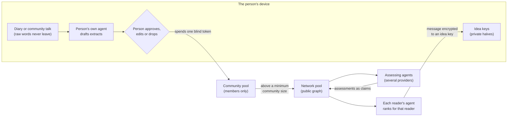

# Idea farm (vision / hypothesis)

**Status:** Vision. It comes from a chat with Markús on 2026-10-27. Under the Experimental Posture ([agents.md](../../agents.md)) it is a hypothesis, and nothing here is built. It replaces the money layer of [Diary, commons and coin](diary-commons-and-coin.md) and keeps the [solo node](solo-node-and-reverse-rag.md) without its stored diary.

Markús decided three things on 2026-10-27. They are recorded as `decision` nodes in [graph/graph.yaml](../../graph/graph.yaml):
1. **It is not about money.** There is no coin, no dividend and no payment.
2. **The platform does not store diaries.** It keeps only the extracts a person approves.
3. **Anonymity is part of the design.**

Everything else below is a proposal. "Idea farm" is a working name.

## The idea in plain terms

- The idea farm is a civic discourse platform.
- People talk or write, either alone (a diary) or in small communities.
- Each person's own agent drafts extracts from what they said: ideas, claims, questions and needs. The person approves each extract. The platform never receives the raw words.
- Approved extracts go into a shared pool, which is a knowledge graph.
- Agents read the pool. They show what each idea rests on, find related ideas, and help people find each other.
- Each idea carries a one-time key. If someone acts on an idea, its originator can prove the idea was theirs without showing who they are. They do this only if and when they choose.
- Participation is anonymous by default.

## What changed from the coin version

| Gone | Why | What happens to it in the graph |
|---|---|---|
| Coin, dividend, two-asset split, funding rounds | Decision 1 | The design items are `superseded`. The money conflicts stay, each linked to the decision that addresses it. |
| Encrypted diary on Walrus | Decision 2 | The erasure conflict on Walrus and Seal mostly falls away: there is no raw text on the platform to erase. |
| Royalty to the commons | Decision 1 | "Commons as author" becomes credit without money (idea keys, below). |

What is new: small communities, agents as readers, attribution without identity, and finding people.

## How the parts fit

## 1. The extract

An extract is the only thing that leaves a person's device. It is the unit of the pool.

- **Kinds:** idea, claim, question, need ("looking for"), offer, and source cited. Claims and sources already exist in the [graph schema](../graph-schema.md). Idea, question, need and offer would be new node types. Adding them is a schema change and is not decided.
- **What it carries:**
  - the text, in words the person approved;
  - the community it came from;
  - the week it was made, not the minute, to blunt timing correlation;
  - the extracting agent's model and version, as on detector flags (rule c);
  - for ideas and needs, a public idea key.
- **What it never carries:** an author name, a wallet, an account or a device id.
- **The person is the editor of their own extract.** They see every draft before it leaves, and they can edit it or drop it. This is the difference from Samtalið, where someone else wrote the one summary sentence per table and AI then summarised the summaries ([manifesto](../manifesto.md)).
- **Raw words** stay on the person's device or are discarded. That is the person's choice. The platform never receives them.

## 2. Anonymity

**Default.** There are no names and no profiles. Participation uses blind tokens (rule e).
- An eligibility proof issues a batch of unlinkable tokens for each period.
- Each extract spends one token.
- This limits volume per person without knowing who the person is. [primitives.md](../../primitives.md) asks for flood protection, and this is the form it takes here.

**Inside a community.** Each community chooses one of two settings:
- anonymous inside, too;
- pseudonymous inside, where members see each other's handles but the network does not.

**Limits.** These are not solved:
- Small communities can identify their members. This is adversary attack 5 ([adversary.md](../adversary.md)).
- Content can identify a person. A diary detail can name its writer.
- Writing style may identify a person, and an agent could link extracts by style. This is not assessed here; experiment 3 tests it.
- Rewriting extracts in a neutral style would blunt style linking. But it removes the person's own voice, which the manifesto values: "the actual words, the hesitations".

## 3. Idea keys: attribution without identity

**How it works:**
- When an extract is an idea or a need, the person's agent creates a fresh key pair for it.
- The public key goes into the pool with the idea. The private key stays with the person's agent.
- A Sui address for an Ed25519 key is the BLAKE2b-256 hash of a scheme flag and the public key (Sui docs, self-description). So each idea has its own one-time wallet address. This is how "attribute to the wallet" can work without exposing anyone.
- Each idea gets a different key. Two ideas from the same person cannot be linked by their keys.

**What it allows:**
- **Proving origin.** Someone acts on an idea. The originator signs a challenge with the idea key. That proves "I hold the key that came with this idea", and nothing else.
- **Contact.** Anyone can send a message encrypted to the idea key, for example "we want to build this, do you want to join?" The originator's agent reads it. The originator decides whether to answer, and as whom.
- **Building on ideas.** A person who extends an idea adds their own idea with its own key and a `derives-from` edge to the original. Credit follows the lineage as a chain of keys, not names. This is "commons as author" without money.
- **Linking to a wallet, by choice.** The originator may sign "this idea key belongs to address W". Only they can make that link. Proposal: never link to the governance wallet (rule e). A person who wants a public track record uses a separate public author identity. That is the opt-in public layer in the [civic contract sketch](../civic-contract-sketch.md).

**Limits:**
- A lost key means the attribution is lost for good.
- Anyone who gets the key can claim the idea.
- A key proves possession, not that the person thought of the idea first. Two people can post the same idea. The pool shows both with their weeks, and a `same-as` edge links them. Neither is removed (rule c).
- A link from an idea key to a wallet is per-person data. Written to a chain, it is permanent, which rule (d) forbids. Proposal: the originator shows the proof directly to the party that acts on the idea, outside the pool. Or the link goes to an erasable store with an end date. Recorded as a conflict.

## 4. Agents reason over ideas, without a verdict

Markús asked for agents that "reason through which ones are good". Rule (c) says flags and scores are claims, never verdicts. This proposal keeps both.

**What assessing agents do:**
- Attach assessments to ideas as claims. Each assessment names the agent, the model and the version. No score is stored as a standing number, and no idea is hidden or deleted.
- An assessment shows four things:
  - what the idea rests on: the nearest supporting and contradicting research and prior art, under the symmetry rule from scoped mode ([meeting-modes.md](../meeting-modes.md));
  - who would gain if it were done (incentive transparency, applied to ideas);
  - what it would need: skills, money, law;
  - similar ideas already in the pool.
- Several agents from different model providers assess the same idea. Where they disagree, the disagreement stays visible. Each model provider is a tie (`cnf:matching-ai-as-undisclosed-tie`).

**Who ranks:**
- **The reader's agent ranks, for that reader only.** Each reader's own agent sorts the pool by that reader's criteria. The platform publishes no global "best ideas" list.
- Anyone, person or agent, may dispute an assessment. The dispute is its own claim.

**Open.** People will still want to see which ideas many found well grounded. Any such view is a soft verdict. Recorded as a conflict.

## 5. Finding people

- A **need** extract ("looking for someone who knows X", "want to work on Y") carries a key, like an idea.
- The person's agent watches the pool for matching ideas, needs and offers. It proposes matches to the person only.
- Contact is a message encrypted to the key. Each side decides whether to reveal anything. The platform keeps no record of the match.
- This answers the open question in [join-keys.md](../join-keys.md) in the person-held direction: the person's agent holds the keys and presents them. The platform never recognises the same person in two places.
- **Communities** form around a place, a topic or an idea that drew people. Each has its own part of the pool. Extracts reach the network only when the community is above a minimum size (rule d). That number is still not set.

## 6. How agents reach the pool

- The pool has a read interface for agents, for example an MCP server over the graph.
- Any agent can read the network pool. A community's pool is open only to its members' agents.
- **Agents write only through a person.** An extract enters the pool only when a person approves it and spends a token.
- Assessments from agents are a separate, labelled kind of node, with the agent as provenance. This is the same exception the detector flags have. It keeps machine output from flooding the human layer.

## 7. Where it runs

Without money, a chain does less. What each part needs:

| Part | What it needs | Candidate |
|---|---|---|
| Extracts in a community | Shared with members; erasable | The community's own node, a federated server, not a chain |
| Network pool (aggregates and ideas above the size floor) | Public; many copies | Walrus fits: it is public by design, and this layer is meant to be public |
| Audit log of commitments | Tamper-evident; witnessed | Sui, or a Certificate-Transparency-style log (`civic.audit`) |
| Eligibility and blind tokens | One person; unlinkable | eID or a zero-knowledge eligibility proof; a Sui object without `store` for the credential |
| Idea keys | Key pairs, signatures, encryption | Any; Sui addresses come from public keys |
| Federation | Nodes cooperate; people can move between nodes | AT Protocol-style signed repositories and portable accounts (self-description) |

Nothing in "find people and share ideas" needs a blockchain. A chain earns its place only for the audit log and the credential. Proposal: run the farm on one node first, without a chain. "Start small. One node."

## Prior art (checked 2026-10-27)

- **Talk to the City**, AI Objectives Institute. Open source under Apache-2.0, active (last push 2026-10-26). It "aggregates responses and organizes similar claims into a nested tree of main topics and subtopics". Self-description (GitHub `AIObjectives/tttc-light-js`). It is the closest tool to the extraction step. The difference: it works on responses an organiser collected, while the farm puts extraction on the person's own agent and the person's approval.
- **AT Protocol.** Signed data repositories that are "like Git repos but for database records". Personal Data Servers. An account can move to a new server "without the server's involvement". Relays gather updates into one firehose, and App Views aggregate data for the network. Self-description (atproto.com). ZKorum plans its Decentralized Deliberation Standard on AT Protocol (prior-art index, entry 3).
- **Sui addresses.** For Ed25519, Secp256k1, Secp256r1 and passkey keys, the address is the BLAKE2b-256 hash of a one-byte scheme flag followed by the public key. Self-description (docs.sui.io, exchange integration guide).
- **Taiwan Join** (prior-art index, entry 11). The agency must contact the proposer. In the farm, the idea key is the contact channel, so no proposer has to be named.
- **Cornell, Laude moonshot** (prior-art index, entry 2). Three layers: AI assistants for individuals, AI moderators for groups, and an independent auditor. The farm has personal agents and assessing agents, and its audit log plays the auditor's part.
- **Gneezy and Rustichini (2000)** (in the graph since PR 23): offering money sometimes lowered performance below offering nothing. This supports decision 1.

## Tensions

These are recorded as `conflict` nodes.

- **Extracts only, against raw signal** (`cnf:extract-only-vs-raw-signal`). The manifesto values the raw words and the hesitations. The farm keeps only what each person approves. The proposed answer is that the person is the editor of their own extract. Still, whatever the person does not extract is gone. Verifiability also has no trail from an extract back to the words; only the person vouches for it.
- **Agents judging ideas** (`cnf:agents-judge-ideas`). "Which ideas are good" is a verdict, which rule (c) forbids. The proposed answer is assessments as claims, several providers, and ranking by each reader's own agent. A network-wide "well grounded" view is still a soft verdict.
- **Claimed attribution against rule (d)** (`cnf:claimed-attribution-vs-rule-d`). A person's voluntary link from an idea key to a wallet is per-person data, and on a chain it is permanent.
- **Anonymity in small communities** (`cnf:anonymity-in-small-communities`). Anonymity is a requirement. Small groups, content and writing style can identify people.

## Experiments, smallest first

1. **An agent reads the existing graph.** Build a read-only MCP server over `graph/graph.yaml`, so any agent can query claims, sources and conflicts. It is the cheapest real test of "agents use the pool", because the pool already exists.
2. **Idea keys.** A short script: make an Ed25519 key per idea, derive its Sui address, sign a challenge, and send a message encrypted to the key. Verify the signature on Sui Testnet.
3. **Style linking.** Can an off-the-shelf model link extracts written by the same person? Then: does an agent's neutral rewrite break the link? The answer decides whether "anonymous" holds at all.
4. **Extraction trial.** Five to ten adult volunteers keep a diary for a week, and their own agent drafts extracts. Measure how often people edit or drop drafts, and what kind of content gets dropped: that is the lost signal. Needs an ethics review and a DPIA first.
5. **One community on one node,** without a chain.

## Not verified

- Whether a deleted record in an AT Protocol repository persists in relays or App Views. The overview page does not say.
- Talk to the City's deployments (Taiwan, Chatham House, UNFCCC). These were seen in directory listings only.
- Whether stylometry can identify the authors of short extracts. This is open until experiment 3.
